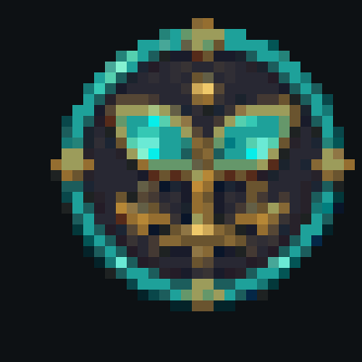
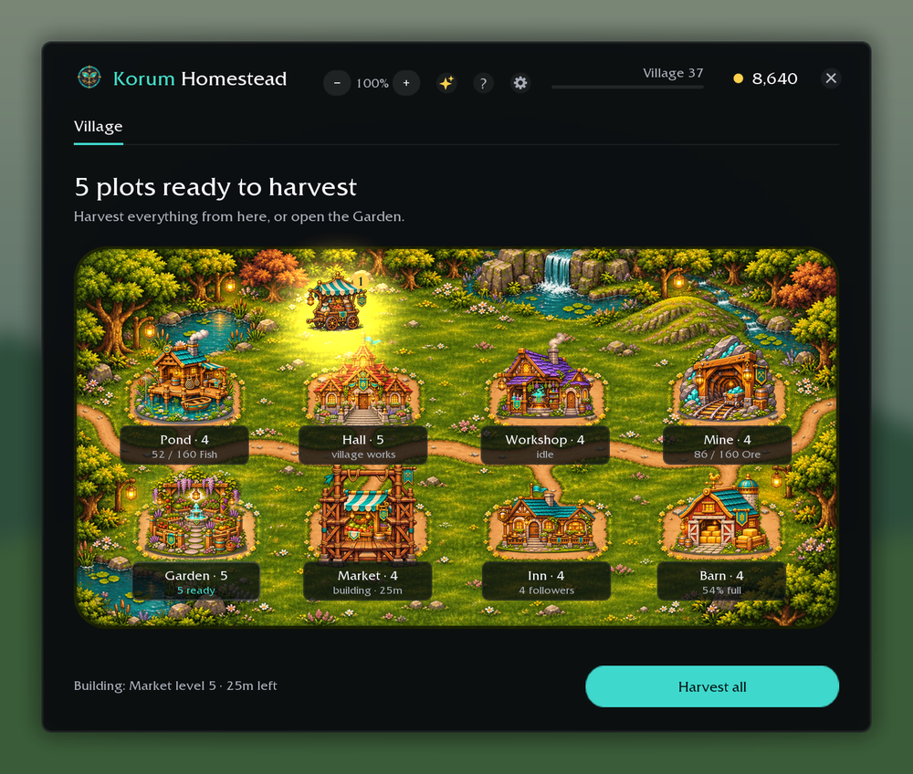
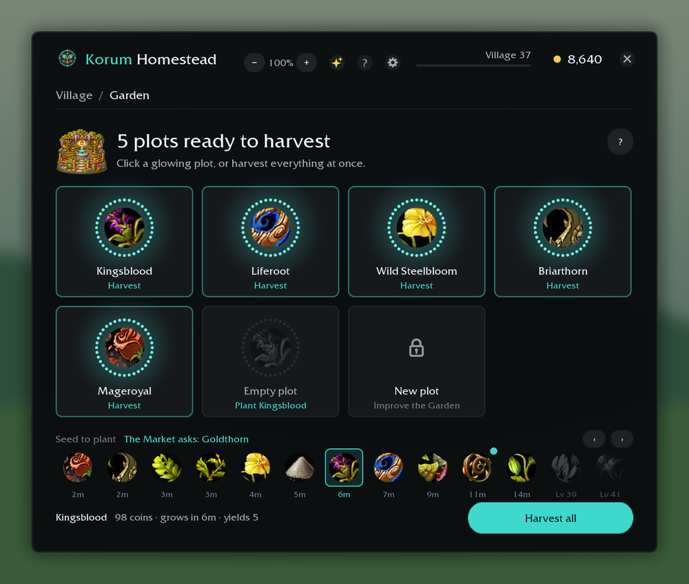
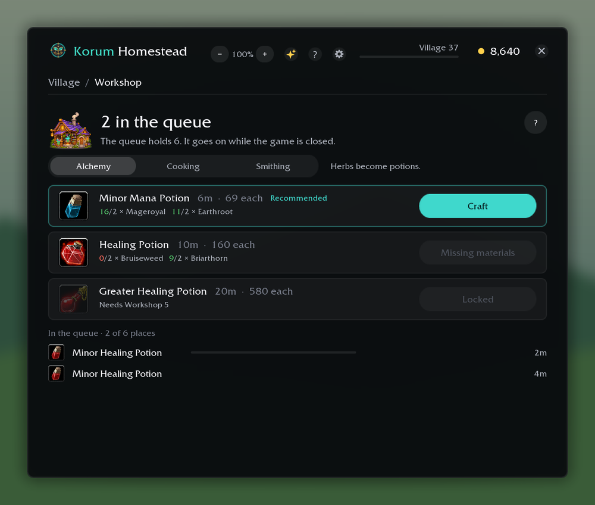
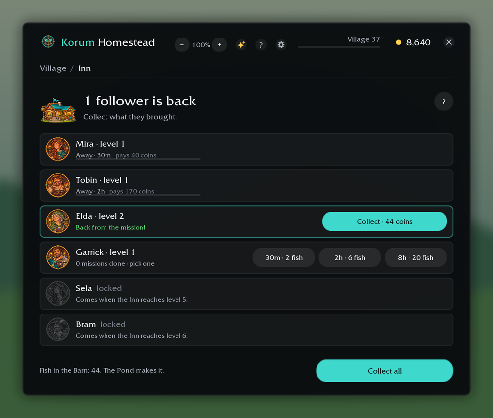
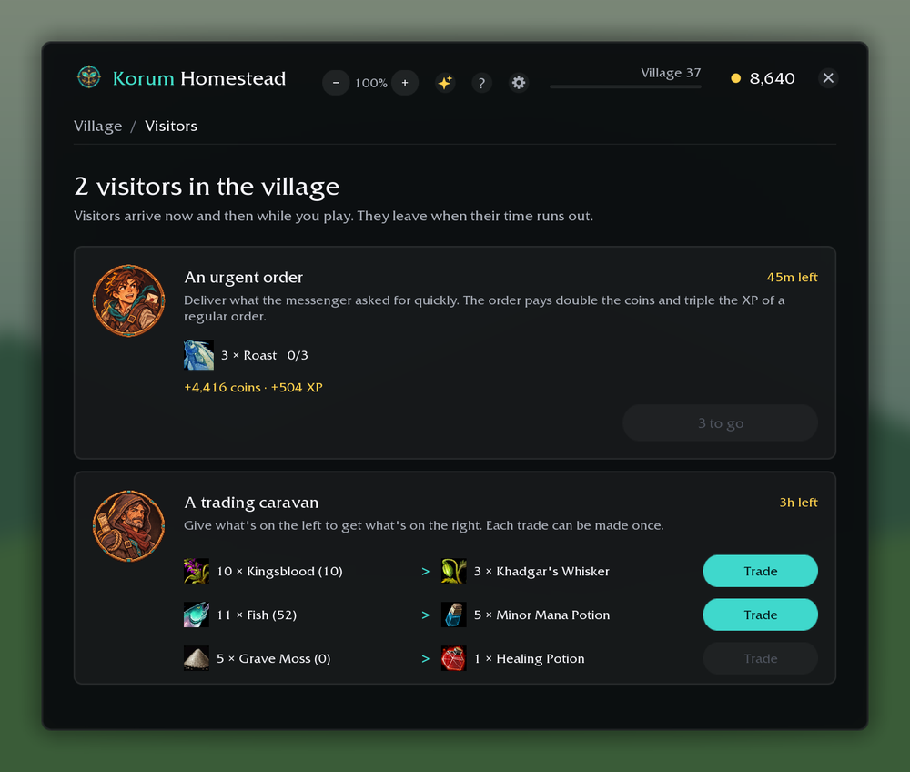

# Korum Homestead

A cozy idle village for World of Warcraft, made for the moments of waiting: the dungeon queue, the flight, the boat,
the minutes before the raid. Grow herbs, build up your village, craft in its workshop and send followers on missions.
Everything runs by the clock, so **your village keeps working while the game is closed**.

It is a minigame of its own: it never touches your character, your bags or your gold, and it needs no other addon.

## Features

- A village map with eight pixel art buildings that grow as you improve them: Hall, Garden, Barn, Market, Mine, Pond,
  Workshop and Inn.
- 13 herbs of the game (with the game's own names and icons, in your language), and a Herbalism level that opens better seeds.
- Orders from the villagers, that pay more than selling.
- A Workshop with three trades in one queue: Alchemy, Cooking and Smithing.
- An Inn with six followers to send on missions.
- A short "how this works" card the first time each place is opened, and a full in-game guide.
- A floating icon with the notifications. English and Brazilian Portuguese.

| | |
|---|---|
|  |  |
|  |  |

## Install

Get it from CurseForge, or download the release zip and put the `KorumHomestead` folder into
`World of Warcraft/<client>/Interface/AddOns/`.
In the game, type `/kh`. It is made for WoW Forever (interface 16001).

## Repository

| Folder | What is there |
|---|---|
| the root | the addon itself: the `.toc`, the Lua files and `Media/` (what goes in the release zip, see `.pkgmeta`) |
| `tests/` | the tests, run against a small mock of the game client: `python -m pytest tests` |
| `ferramentas/simulador_ui.py` | a UI simulator that opens the addon outside the game and saves pictures of its screens |
| `ferramentas/importar_arte_homestead.py` | brings the pixel art of `arquivo/arte_v3/` into the addon as TGA files |
| `ferramentas/curse_homestead.py` | the logo and the screenshots of the CurseForge page |
| `arquivo/arte_v3/` | the pixel art sources (PNG, real grid and @2x) |

The tests and tools need Python 3 with `lupa` and `Pillow` (`pip install lupa pillow`).

## Releases

CurseForge packages the addon from this repository when a version tag is pushed (`git tag v1.0.1` and
`git push --tags`). `.pkgmeta` leaves the tests, the tools, the art sources and the docs out of the zip.

## License

All rights reserved. See [LICENSE](LICENSE). World of Warcraft is a trademark of Blizzard Entertainment, Inc.;
this project is not affiliated with Blizzard Entertainment.
