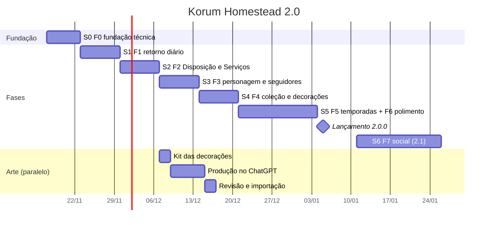

# Korum Homestead 2.0: cronograma de implementação

Complementa o [plano de desenvolvimento](plano-2.0.md), que diz **o que** a 2.0 tem. Este documento diz **quem faz o
quê e quando**.

- **Início:** terça, 17/11/2026
- **2.0.0 publicada:** terça, 05/01/2027
- **2.1 (social):** segunda, 25/01/2027
- **Ritmo:** sprints de uma semana (segunda a domingo), um alpha no CurseForge no fim de cada sprint de fase.

> **Tipo de arquivo no CurseForge.** Toda versão de trabalho da 2.0 sai como **Alpha**, para não tomar o lugar da 1.0.1
> de quem usa a versão estável. O CurseForge decide o tipo pela tag: com `alpha` no nome vira Alpha, com `beta` vira
> Beta, e **sem nenhum dos dois vira Release**. Por isso as tags são `v2.0.0-alpha1`, `v2.0.0-alpha2`... e só a
> `v2.0.0` não tem sufixo. Nunca usar `-rc1` ou outro sufixo sem `alpha`: o CurseForge publicaria como Release.

---

## 1. Papéis

| Quem | Papel | Responsável por |
|---|---|---|
| **Eu** | Dono do produto e testador no jogo | Decisões de produto, prioridades e equilíbrio; **todo teste dentro do jogo** (só você roda o WoW); arte com o ChatGPT; capturas de tela reais; aprovar e publicar no CurseForge; tokens e acessos |
| **Claude** | Arquiteto, líder técnico e gestor do projeto | Arquitetura e modelo de dados; migrações de save; sistemas centrais e telas novas; escrever as tarefas do Codex; revisar e integrar o código do Codex; simulador; versões, tags e changelog; manter este cronograma atualizado |
| **Codex** | Engenheiro de implementação | Tarefas bem especificadas: refatorações mecânicas, lógica com regras fechadas, testes automáticos, textos em EN/ptBR, tabelas de conteúdo, cenas do simulador, scripts de apoio |

**Regra de divisão:** o que exige decisão de desenho fica com Claude; o que tem especificação fechada e critério de
aceite testável vai para o Codex; o que exige o jogo aberto ou uma decisão de produto fica com você.

## 2. Como trabalhamos

### Repositório
- **O Homestead é desenvolvido neste repositório** (`C:\AI\Code\KorumHomestead`, no GitHub), com o addon na raiz. O
  repositório dos outros addons Korum não tem mais cópia dele; o instalador de lá lê daqui e leva ao jogo só o que é do
  addon (a mesma lista do `.pkgmeta`). O Codex trabalha aqui por pull requests, e o CurseForge empacota daqui.
- Branch `main` sempre jogável. Cada tarefa num branch: `claude/T1.2-resumo`, `codex/T1.4-encomenda-do-dia`.
- **GitHub Actions** roda os testes em todo pull request (T0.2). Nada entra na `main` com teste falhando.

### Fluxo de uma tarefa do Codex
1. Claude escreve o **briefing** em `docs/tarefas/T-x.y.md`: objetivo, arquivos, regras, dados, critério de aceite,
   testes que precisam passar, o que não mexer.
2. Codex implementa no branch `codex/T-x.y-...` e abre um pull request.
3. Claude revisa (correção, estilo do projeto, independência, EN/ptBR, telas no simulador) e pede ajustes ou integra.
4. Você confere no jogo no teste de sábado.

### Fluxo de uma tarefa de Claude
Branch próprio, testes junto, captura do simulador no pull request, integração depois dos testes verdes.

### Rotina semanal
| Quando | O quê | Quem |
|---|---|---|
| Segunda | Abertura do sprint: o que entra, briefings do Codex prontos | Claude (você aprova) |
| Terça a sexta | Implementação e revisões | Claude e Codex |
| Sexta | Build de teste instalado no Forever + lista do que conferir | Claude |
| Sábado | **Teste no jogo** (1 a 2 h) e relato do que falhou | Eu |
| Domingo | Correções, tag do alpha, publicação | Claude (tag) e Eu (conferir CurseForge) |

### Definição de pronto (vale para toda tarefa)
- Testes automáticos novos e antigos passando (GitHub Actions verde).
- Textos em inglês e português, sem chave faltando.
- Toda função com controle na tela e cartão "como funciona" quando a tela é nova.
- Captura do simulador revisada.
- Save da 1.0 e dos alphas anteriores abre sem erro (teste de migração).
- Sem dependência de outro addon.

---

## 3. Marcos

| Marco | Data | Conteúdo | Tag |
|---|---|---|---|
| M0 | dom 22/11 | Fundação técnica pronta, nada mudou para o jogador | ✅ atingido em 17/11 |
| M1 | dom 29/11 | **Alpha 1:** resumo ao voltar, encomenda do dia, sequência | `v2.0.0-alpha1` |
| M2 | dom 06/12 | **Alpha 2:** Disposição e Serviços | `v2.0.0-alpha2` |
| M3 | dom 13/12 | **Alpha 3:** atributos, seguidores com especialidade, risco e achados | `v2.0.0-alpha3` |
| M4 | dom 20/12 | **Alpha 4:** herbário, conquistas, decorações no mapa | `v2.0.0-alpha4` |
| M5 | dom 03/01 | **Candidato final:** temporadas, som, animação, equilíbrio | `v2.0.0-alpha5` |
| **M6** | **ter 05/01** | **Korum Homestead 2.0.0** | `v2.0.0` |
| M7 | seg 25/01 | 2.1: social com amigos | `v2.1.0` |

Folga: a semana de 22/12 a 03/01 tem festas; o sprint 5 tem duas semanas por isso.

---

## 4. Cronograma detalhado

Legenda: **h** = estimativa em horas de trabalho; **Dep.** = depende de.

### Sprint 0: Fundação técnica (ter 17/11 a dom 22/11)

| ID | Tarefa | Quem | Dep. | Data | h | Entrega / aceite |
|---|---|---|---|---|---|---|
| T0.1 | Aprovar a mudança do desenvolvimento para o repositório próprio do GitHub | **Eu** | — | 17/11 | 0,5 | ✅ feito em 17/11 |
| T0.2 | GitHub Actions: rodar os testes em todo push e pull request | Claude | T0.1 | 18/11 | 1 | ✅ feito em 17/11 (`.github/workflows/tests.yml`) |
| T0.3 | Instalador lendo o Homestead do repositório próprio; tirar a cópia do monorepo | Claude | T0.1 | 18/11 | 1 | ✅ feito em 17/11 |
| T0.4 | Guardar uma amostra do save real: copiar `WTF\Account\...\SavedVariables\KorumHomestead.lua` para Claude | **Eu** | — | 18/11 | 0,2 | ✅ feito em 17/11 |
| T0.5 | Briefings das tarefas T0.6, T0.8 e T0.9 | Claude | T0.1 | 18/11 | 1,5 | ✅ feito em 17/11 |
| T0.6 | Dividir `UI.lua` em `UI.lua` + `Screens/*.lua` (um arquivo por tela), sem mudar comportamento | **Codex** | T0.5 | 19–20/11 | 5 | ✅ feito em 17/11 (PR #1: 53 testes, 17 capturas idênticas) |
| T0.7 | `db.schema` e `Migrate.lua` (uma função por versão), com a amostra real como teste | Claude | T0.4 | 19/11 | 2 | ✅ feito em 17/11 (PR #2) |
| T0.8 | `Balance.lua`: levar todos os números de equilíbrio para um arquivo | **Codex** | T0.6 | 20/11 | 2 | ✅ feito em 17/11 |
| T0.9 | `KH.Day()` (dia local virando à meia-noite) e um relógio controlável nos testes | **Codex** | T0.5 | 20/11 | 1 | ✅ feito em 17/11 |
| T0.10 | Revisar e integrar T0.6, T0.8, T0.9 | Claude | T0.6–T0.9 | 21/11 | 2 | ✅ feito em 17/11 |
| T0.11 | Teste de regressão no jogo: tudo continua igual | **Eu** | T0.10 | 21–22/11 | 1 | ✅ ok em 17/11 (save migrado para schema 2, nada perdido) |

### Sprint 1: Retorno diário (seg 23/11 a dom 29/11) → Alpha 1

| ID | Tarefa | Quem | Dep. | Data | h | Entrega / aceite |
|---|---|---|---|---|---|---|
| T1.1 | Especificação da F1 e briefings T1.4, T1.6, T1.7 | Claude | M0 | 23/11 | 2 | ✅ feito em 17/11 (`docs/tarefas/T1.4.md`, `T1.6.md`, `T1.7.md`) |
| T1.2 | Aprovar as recompensas da sequência (dias 3, 7, 14, 30) e o item raro do 7º dia | **Eu** | T1.1 | 23/11 | 0,3 | ✅ 17/11: proposta do `T1.4.md` aprovada |
| T1.3 | Resumo ao voltar: `db.lastSeen`, fotografia dos contadores, cálculo do que mudou | Claude | M0 | 24/11 | 3 | testes com 30 min, 8 h e 3 dias fora |
| T1.4 | Encomenda do dia e sequência: sorteio por dia, entrega, contagem, zerar, recorde | **Codex** | T1.1 | 24–25/11 | 4 | testes com o relógio adiantado: troca à meia-noite, sequência conta e zera |
| T1.5 | Cartão "Enquanto você esteve fora" com "Coletar tudo"; encomenda do dia no Mercado; ponto no ícone flutuante | Claude | T1.3, T1.4 | 26/11 | 4 | capturas do simulador |
| T1.6 | Textos EN/ptBR da F1 e cartão "como funciona" atualizado do Mercado | **Codex** | T1.5 | 26/11 | 1,5 | nenhuma chave faltando |
| T1.7 | Cenas do simulador da F1 (resumo, encomenda do dia, sequência no 7º dia) | **Codex** | T1.5 | 27/11 | 1 | imagens em `arquivo/telas` |
| T1.8 | Revisão, integração e build de teste instalado no Forever | Claude | T1.4–T1.7 | 27/11 | 2 | lista do que conferir no jogo |
| T1.9 | Teste no jogo da F1 | **Eu** | T1.8 | 28/11 | 1,5 | relato |
| T1.10 | Correções do teste | Claude | T1.9 | 29/11 | 1–3 | — |
| T1.11 | Changelog, tag `v2.0.0-alpha1`, conferir o arquivo no CurseForge (como **Alpha**) | Claude + **Eu** | T1.10 | 29/11 | 0,5 | alpha publicado |

### Sprint 2: Disposição e Serviços (seg 30/11 a dom 06/12) → Alpha 2

| ID | Tarefa | Quem | Dep. | Data | h | Entrega / aceite |
|---|---|---|---|---|---|---|
| T2.1 | Especificação da F2 e briefings T2.4, T2.5, T2.7, T2.8 | Claude | M1 | 30/11 | 2 | briefings |
| T2.2 | Aprovar os 6 serviços (nomes, custos, chances, recompensas) | **Eu** | T2.1 | 30/11 | 0,3 | decisão |
| T2.3 | Disposição: valor, recarga com o jogo fechado, máximo por nível, gasto | Claude | M1 | 01/12 | 2 | testes de recarga (12 min, 2 h, 3 dias) |
| T2.4 | Serviços: quadro de 3 por hora, sorteio com semente fixa, sucesso, falha com consolo | **Codex** | T2.1 | 01–02/12 | 4 | testes com sorteio fixo batendo com a tabela |
| T2.5 | Propor itens do jogo para os ícones dos serviços e recompensas (IDs conferidos na base do guia) | **Codex** | T2.1 | 01/12 | 1 | lista de IDs no pull request |
| T2.6 | Barra de Disposição no cabeçalho; tela do Quadro de Serviços; resultado com animação curta | Claude | T2.3, T2.4 | 03/12 | 4 | capturas; cabeçalho cabe em EN e ptBR |
| T2.7 | Textos EN/ptBR dos serviços (nome, descrição, frase de sucesso e de falha) | **Codex** | T2.2 | 03/12 | 1,5 | chaves completas |
| T2.8 | Cenas do simulador da F2 | **Codex** | T2.6 | 04/12 | 1 | imagens |
| T2.9 | Conferência de equilíbrio: moedas por hora dos serviços contra a Horta | Claude | T2.4 | 04/12 | 1 | serviços rendem menos que a Horta por hora |
| T2.10 | Revisão, integração, build de teste | Claude | T2.4–T2.9 | 04/12 | 2 | lista do que conferir |
| T2.11 | Teste no jogo da F2 | **Eu** | T2.10 | 05/12 | 1,5 | relato |
| T2.12 | Correções e tag `v2.0.0-alpha2` | Claude + **Eu** | T2.11 | 06/12 | 1–3 | alpha publicado |

### Sprint 3: Personagem e seguidores (seg 07/12 a dom 13/12) → Alpha 3

| ID | Tarefa | Quem | Dep. | Data | h | Entrega / aceite |
|---|---|---|---|---|---|---|
| T3.1 | Especificação da F3 e briefings T3.4, T3.5, T3.7, T3.8 | Claude | M2 | 07/12 | 2 | briefings |
| T3.2 | Aprovar os quatro atributos, os valores por ponto e as especialidades dos seis seguidores | **Eu** | T3.1 | 07/12 | 0,3 | decisão |
| T3.3 | Atributos: pontos por nível, migração (pontos dos níveis que o save já tem), redistribuir com custo | Claude | M2 | 08/12 | 3 | teste de migração dá os pontos certos |
| T3.4 | Aplicar os bônus dos atributos em Horta, Mercado, Oficina, Estalagem e Serviços | **Codex** | T3.3 | 08–09/12 | 4 | testes por bônus; números na tela já com o bônus |
| T3.5 | Seguidores: especialidade em casa, risco de ferimento, descanso, achados raros | **Codex** | T3.1 | 09–10/12 | 4 | testes com sorteio fixo |
| T3.6 | Tela do personagem (atributos e "de onde vem cada bônus"); Estalagem com especialidade, ferido e achado | Claude | T3.3–T3.5 | 10–11/12 | 5 | capturas |
| T3.7 | Textos EN/ptBR da F3 | **Codex** | T3.6 | 11/12 | 1,5 | chaves completas |
| T3.8 | Cenas do simulador da F3 | **Codex** | T3.6 | 11/12 | 1 | imagens |
| T3.9 | Revisão, integração, build de teste | Claude | T3.4–T3.8 | 11/12 | 2 | lista do que conferir |
| T3.10 | Teste no jogo da F3 | **Eu** | T3.9 | 12/12 | 1,5 | relato |
| T3.11 | Correções e tag `v2.0.0-alpha3` | Claude + **Eu** | T3.10 | 13/12 | 1–3 | alpha publicado |

### Arte das decorações (em paralelo, 07/12 a 16/12)

| ID | Tarefa | Quem | Dep. | Data | h | Entrega / aceite |
|---|---|---|---|---|---|---|
| A1 | Definir as 10 decorações e as posições livres no mapa | Claude | — | 07/12 | 1,5 | mapa marcado com os pontos |
| A2 | Kit para o ChatGPT: LEIA-ME com medidas, referências aprovadas, mapa com os pontos | Claude | A1 | 08/12 | 1,5 | `kit_decoracoes.zip` |
| A3 | Produzir as decorações no ChatGPT | **Eu** | A2 | 09–14/12 | 3–5 | 10 imagens (grade real + @2x) |
| A4 | Revisar a arte (estilo, medidas, pixels soltos) e pedir ajustes | Claude | A3 | 15/12 | 1 | aprovado ou lista de ajustes |
| A5 | Importar para o addon (estender o importador) | **Codex** | A4 | 16/12 | 1 | TGAs em `Media/Village/` |

### Sprint 4: Coleção, conquistas e decorações (seg 14/12 a dom 20/12) → Alpha 4

| ID | Tarefa | Quem | Dep. | Data | h | Entrega / aceite |
|---|---|---|---|---|---|---|
| T4.1 | Especificação da F4 e briefings T4.3, T4.4, T4.6, T4.7 | Claude | M3 | 14/12 | 2 | briefings |
| T4.2 | Motor de conquistas: registro de eventos, progresso, pontos de vila, prêmios dados uma vez | Claude | M3 | 14–15/12 | 3 | testes; o que já foi feito no save conta |
| T4.3 | Herbário: catálogo (ervas, receitas, produtos, raros), visto ou não, contagem desde o save antigo | **Codex** | T4.1 | 15/12 | 3 | testes de contagem |
| T4.4 | Lista das ~40 conquistas e dos ~12 itens raros (com IDs de itens do jogo conferidos) | **Codex** | T4.1 | 15/12 | 2 | tabela no pull request |
| T4.5 | Aprovar conquistas, raros e quais marcos liberam cada decoração | **Eu** | T4.4 | 16/12 | 0,5 | decisão |
| T4.6 | Telas: Herbário (álbum com silhuetas) e Conquistas (grupos, progresso) | Claude | T4.2, T4.3 | 16–17/12 | 5 | capturas |
| T4.7 | Decorações no mapa: posições, ligar e desligar, tela de decorações | Claude | A5, T4.2 | 17/12 | 3 | capturas com e sem decorações |
| T4.8 | Textos EN/ptBR da F4 (conquistas, raros, telas) | **Codex** | T4.5 | 17/12 | 2 | chaves completas |
| T4.9 | Cenas do simulador da F4 | **Codex** | T4.6, T4.7 | 18/12 | 1 | imagens |
| T4.10 | Revisão, integração, build de teste | Claude | T4.3–T4.9 | 18/12 | 2 | lista do que conferir |
| T4.11 | Teste no jogo da F4 | **Eu** | T4.10 | 19/12 | 2 | relato |
| T4.12 | Correções e tag `v2.0.0-alpha4` | Claude + **Eu** | T4.11 | 20/12 | 1–3 | alpha publicado |

### Sprint 5: Temporadas, polimento e lançamento (seg 21/12 a ter 05/01, com festas)

| ID | Tarefa | Quem | Dep. | Data | h | Entrega / aceite |
|---|---|---|---|---|---|---|
| T5.1 | Especificação da F5 e F6 e briefings T5.4, T5.5, T5.7, T5.10 | Claude | M4 | 21/12 | 2 | briefings |
| T5.2 | Aprovar duração das temporadas, faixas de prêmio e o selo de cada temporada | **Eu** | T5.1 | 21/12 | 0,3 | decisão |
| T5.3 | Calendário de temporadas (fixo, sem servidor), pontos, histórico, virada | Claude | M4 | 22/12 | 3 | testes de virada com o relógio adiantado |
| T5.4 | Banco de metas semanais (~30) e sorteio de 3 por semana pelo número da temporada | **Codex** | T5.1 | 22–23/12 | 3 | testes: mesma temporada sorteia as mesmas metas |
| T5.5 | Prêmios por faixa e decoração exclusiva por temporada (dados uma vez só) | **Codex** | T5.3 | 23/12 | 2 | testes |
| T5.6 | Tela da temporada e indicador no cabeçalho ("Temporada 3 · faltam 9 dias") | Claude | T5.3–T5.5 | 28/12 | 4 | capturas |
| T5.7 | Sons do jogo nos eventos (colher, vender, obra, nível, serviço) com opção de desligar | **Codex** | T5.1 | 28/12 | 2 | lista de sons; opção nas configurações |
| T5.8 | Conferir no jogo se os sons tocam e escolher os que ficam | **Eu** | T5.7 | 29/12 | 0,5 | lista aprovada |
| T5.9 | Animações: moedas voando, brilho da obra terminada, comemoração de nível | Claude | M4 | 29/12 | 3 | capturas em sequência |
| T5.10 | Script de equilíbrio: moedas e XP por hora de cada atividade, por nível | **Codex** | T5.1 | 29/12 | 2 | tabela gerada |
| T5.11 | Análise do equilíbrio e proposta de ajustes em `Balance.lua` | Claude | T5.10 | 30/12 | 2 | proposta |
| T5.12 | Aprovar os ajustes de equilíbrio | **Eu** | T5.11 | 30/12 | 0,5 | decisão |
| T5.13 | Textos EN/ptBR da F5 e F6, guia do jogo atualizado com tudo da 2.0 | **Codex** | T5.6 | 30/12 | 2 | chaves completas; guia com as novidades |
| T5.14 | Revisão final, build e tag `v2.0.0-alpha5` (candidato final) | Claude | T5.3–T5.13 | 02/01 | 3 | candidato publicado como Alpha |
| T5.15 | Teste completo no jogo (começar do zero e com save antigo) | **Eu** | T5.14 | 03/01 | 2–3 | relato |
| T5.16 | Capturas de tela reais no jogo, em inglês, para o CurseForge e o GitHub | **Eu** | T5.14 | 03/01 | 1 | 7 imagens |
| T5.17 | Correções do candidato | Claude | T5.15 | 04/01 | 1–4 | — |
| T5.18 | Página do CurseForge e README da 2.0 (texto e imagens) | Claude | T5.16 | 04/01 | 1,5 | `description.md` e README novos |
| T5.19 | Tag `v2.0.0`, conferir o arquivo e atualizar a página no CurseForge | Claude + **Eu** | T5.17, T5.18 | 05/01 | 0,5 | **2.0.0 publicada** |

### Sprint 6: Social com amigos, 2.1 (seg 11/01 a seg 25/01)

| ID | Tarefa | Quem | Dep. | Data | h | Entrega / aceite |
|---|---|---|---|---|---|---|
| T6.1 | Script de teste para mensagens de addon no Forever | Claude | M6 | 11/01 | 1 | comando de teste |
| T6.2 | Rodar o teste com um amigo ou segunda conta (envio, recebimento, limite) | **Eu** | T6.1 | 12/01 | 1 | relato: funciona ou não |
| T6.3 | **Ponto de decisão:** seguir com a F7 ou adiar | **Eu** | T6.2 | 12/01 | 0,2 | decisão |
| T6.4 | Protocolo: resumo da vila, presente diário, pontos da temporada; limites e versões | Claude | T6.3 | 13/01 | 3 | documento do protocolo e testes |
| T6.5 | Implementar envio, recebimento, fila com limite e lista de amigos | **Codex** | T6.4 | 14–16/01 | 5 | testes com dois clientes simulados |
| T6.6 | Tela de amigos (vila do amigo, mandar presente, comparação da temporada) | Claude | T6.5 | 18–19/01 | 4 | capturas |
| T6.7 | Textos EN/ptBR e cenas do simulador da F7 | **Codex** | T6.6 | 20/01 | 1,5 | chaves e imagens |
| T6.8 | Teste no jogo com um amigo | **Eu** | T6.7 | 23/01 | 1,5 | relato |
| T6.9 | Correções e tag `v2.1.0` | Claude + **Eu** | T6.8 | 25/01 | 1–3 | **2.1 publicada** |

---

## 5. Carga por pessoa

| Sprint | Eu | Claude | Codex |
|---|---|---|---|
| S0 Fundação | ~2 h | ~7,5 h | ~8 h |
| S1 Retorno diário | ~2,5 h | ~13 h | ~6,5 h |
| S2 Disposição | ~2 h | ~12 h | ~7,5 h |
| S3 Personagem | ~2 h | ~13 h | ~10,5 h |
| Arte (paralelo) | ~3–5 h | ~4 h | ~1 h |
| S4 Coleção | ~2,5 h | ~16 h | ~8 h |
| S5 Temporadas | ~5 h | ~24 h | ~11 h |
| S6 Social | ~3 h | ~10 h | ~6,5 h |
| **Total** | **~22 h** | **~100 h** | **~59 h** |

Seu tempo se concentra no **sábado** (teste no jogo) e em decisões curtas na **segunda**.

## 6. Riscos e plano de resposta

| Risco | Prob. | Impacto | Resposta |
|---|---|---|---|
| Teste no jogo atrasa (sábado sem tempo) | média | alpha escorrega uma semana | o alpha sai no domingo seguinte; o sprint seguinte começa mesmo assim |
| Arte das decorações demora ou não fica boa | média | F4 sem decorações | F4 sai com herbário e conquistas; decorações entram no alpha seguinte |
| Janela cheia com cinco sistemas novos | média | telas apertadas | cada sistema entra por um lugar só; revisão de layout no simulador em toda tarefa de tela |
| Briefing do Codex ambíguo gera retrabalho | média | +1 dia | briefing com critério de aceite e testes obrigatórios; dúvidas do Codex respondidas no pull request |
| Save antigo quebra numa migração | baixa | alto (jogador perde vila) | teste de migração com save real em todo pull request; migração nunca apaga campos |
| Som ou mensagens de addon não funcionam no Forever | média | F6 ou F7 reduzidas | conferido no jogo antes de implementar (T5.8, T6.2); F7 tem ponto de decisão |
| Webhook do CurseForge falha numa tag | baixa | alpha não sai | Claude confere a entrega do webhook; reenvio da tag ou zip à mão |
| Festas de fim de ano | alta | S5 mais lento | S5 já tem duas semanas |

## 7. Lista de verificação de lançamento (cada alpha e a 2.0.0)

- [ ] GitHub Actions verde na `main`
- [ ] `## Version` do `.toc` e `CHANGELOG.md` atualizados
- [ ] Save da 1.0 e do alpha anterior abrem no jogo
- [ ] Teste de sábado sem falha aberta
- [ ] Tag enviada e entrega do webhook com resposta 200
- [ ] Arquivo no CurseForge com o tipo certo (Alpha ou Release) e a versão do jogo certa
- [ ] Página e README atualizados (na 2.0.0)

## 8. Próximo passo

T0.1 a T0.3 concluídas em 17/11. Em seguida: **T0.4** (você manda a amostra do save) e **T0.5** (Claude escreve os
briefings do Codex para T0.6, T0.8 e T0.9).
