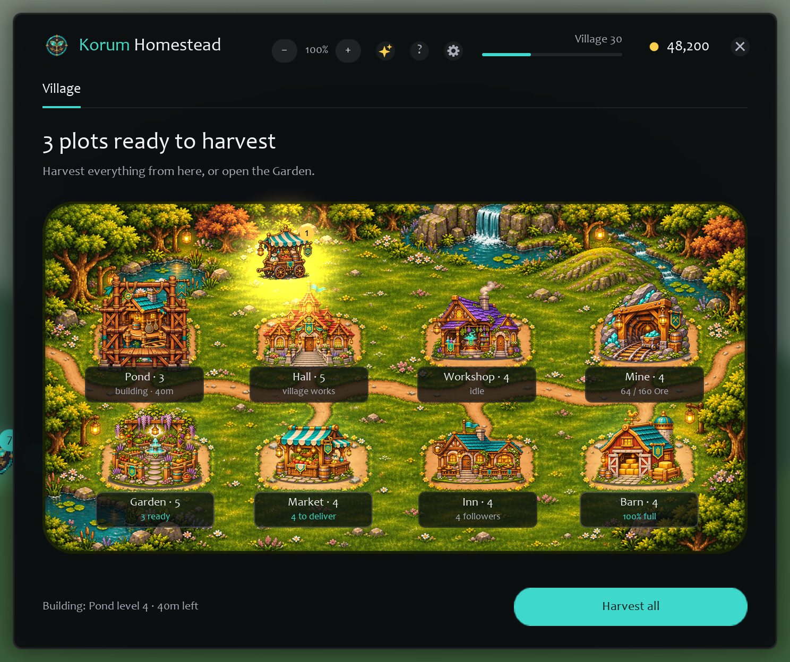
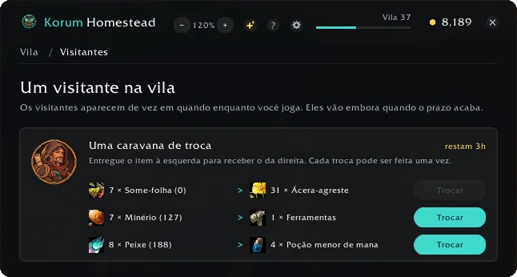
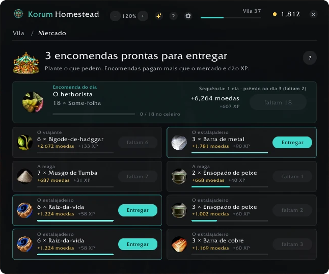
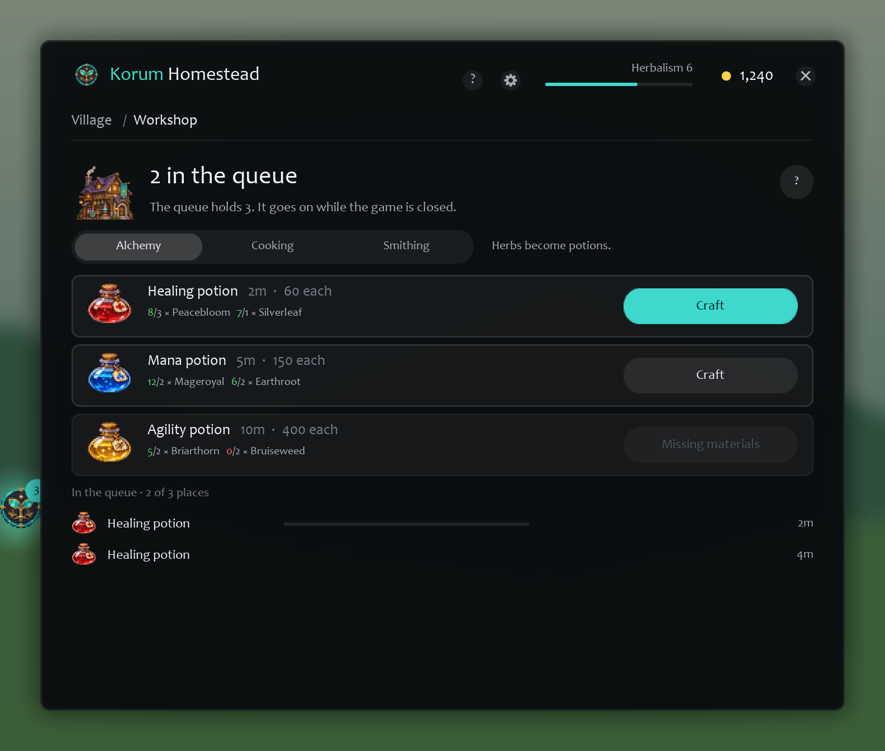
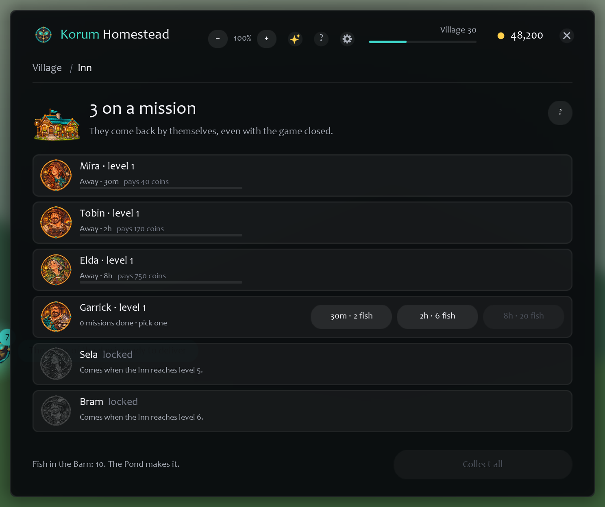

## A cozy little village between adventures

Waiting for a dungeon? Taking a flight or a boat? Got a few minutes before the next raid?

Why not spend that time building a village of your own?

Grow herbs, craft useful goods, improve your buildings, welcome visitors and send followers on adventures. Your village keeps growing even when you're away, so there's always something waiting when you return.

Korum Homestead is a little world of its own. It doesn't interact with your character, inventory or gold. Everything you earn and build stays within the village. No extra addons required.

## Features

*   **Village** - eight buildings on a hand-drawn map, each with seven levels. Your Village grows from level 1 to 60, and every level opens something new.
*   **Garden** - grow 27 herbs from the game, from Peacebloom to Icecap, each with its own growing time.
*   **Barn and Market** - sell your harvest, or fill the villagers' orders (herbs and Workshop goods) for more coins and XP. An order of the day rewards you for coming back day after day.
*   **Hall** - improve your village one project at a time. It points out the best upgrade for now.
*   **Mine and Pond** - ore and fish pile up as time goes by.
*   **Workshop** - 21 recipes in Alchemy, Cooking and Smithing. Crafted goods are always worth more than their ingredients.
*   **Inn** - recruit up to six followers and send them on missions. They come back with coins and goods, and grow more experienced along the way.
*   **Visitors** - now and then, while you play, someone arrives: a messenger with an urgent order, a generous merchant, a trading caravan, a rare fish in the Pond or a rare vein in the Mine. They don't stay long! *(2.1 alpha)*
*   **While you were away** - when you come back, a card shows what's ready, who returned and what was made.
*   **Easy to learn** - each building introduces itself the first time you visit, and there's a complete guide whenever you need it.
*   **Always close by** - minimize your village into a floating icon that tells you when something needs you. Move it anywhere on your screen, or use the minimap button.
*   **Made for your adventures** - the village hides itself when combat begins.
*   **One village per account.**
*   **Available in English and Brazilian Portuguese.**

## How to start

Type **/kh**, click the village icon or use the minimap button.

Your village is ready to welcome you. Head to the Garden, choose a seed and plant it. Come back when it's ready, collect your herbs, visit the Market and start making your village a little bigger.

Coming from version 1.0? Your village is carried over, and nothing you had is lost.

## Commands

*   **/kh** - open or close your village
*   **/kh harvest** - collect everything that's ready
*   **/kh help** - see all available commands

## Feedback

Have an idea, found something broken or just want to share your thoughts?

Leave a comment or open an issue on [GitHub](https://github.com/joaomenestrina-debug/KorumHomestead).

***

## Uma pequena vila entre aventuras

Esperando na fila de uma masmorra? Fazendo uma viagem de barco ou voo? Tem alguns minutos antes da próxima raide?

Que tal aproveitar esse tempo para construir sua própria vila?

Cultive ervas, produza itens, melhore suas construções, receba visitantes e envie seus seguidores em missões. Sua vila continua crescendo mesmo quando você está longe, então sempre haverá algo esperando por você quando voltar.

Korum Homestead é um pequeno mundo à parte. Ele não interfere no seu personagem, inventário ou ouro. Tudo o que você conquista e constrói fica dentro da vila. Nenhum outro addon é necessário.

## Funcionalidades

*   **Vila** - oito construções num mapa desenhado à mão, cada uma com sete níveis. Sua Vila cresce do nível 1 ao 60, e cada nível libera algo novo.
*   **Horta** - cultive 27 ervas do jogo, das mais simples às mais raras, cada uma com seu próprio tempo de crescimento.
*   **Celeiro e Mercado** - venda sua colheita ou atenda às encomendas dos moradores (ervas e itens da Oficina) para ganhar mais moedas e XP. A encomenda do dia recompensa quem volta dia após dia.
*   **Sede** - melhore sua vila, uma obra de cada vez. Ela mostra a melhor melhoria para o momento.
*   **Mina e Lagoa** - minério e peixe se acumulam com o passar do tempo.
*   **Oficina** - 21 receitas de Alquimia, Culinária e Ferraria. O que você fabrica sempre vale mais que os ingredientes.
*   **Estalagem** - recrute até seis seguidores e envie-os em missões. Eles voltam com moedas e mercadorias, ficando mais experientes a cada jornada.
*   **Visitantes** - de vez em quando, enquanto você joga, alguém chega: um mensageiro com um pedido urgente, um mercador generoso, uma caravana de troca, um peixe raro na Lagoa ou um veio raro na Mina. Eles não ficam muito tempo! *(2.1 alpha)*
*   **Enquanto você esteve fora** - ao voltar, um cartão mostra o que está pronto, quem voltou e o que foi produzido.
*   **Fácil de aprender** - cada construção se apresenta na primeira visita, e há um guia completo sempre que você precisar.
*   **Sempre por perto** - minimize sua vila em um ícone flutuante que avisa quando algo precisa de você. Posicione-o onde quiser na tela ou use o botão no minimapa.
*   **Feito para suas aventuras** - a vila se esconde automaticamente quando um combate começa.
*   **Uma vila por conta.**
*   **Disponível em inglês e português brasileiro.**

## Como começar

Digite **/kh**, clique no ícone da vila ou use o botão no minimapa.

Sua vila está pronta para receber você. Vá até a Horta, escolha uma semente e plante. Volte quando estiver pronta, faça a colheita, visite o Mercado e comece a aumentar sua vila.

Vem da versão 1.0? Sua vila é mantida, e nada do que você tinha se perde.

## Comandos

*   **/kh** - abre ou fecha sua vila
*   **/kh colher** (ou **/kh harvest**) - colhe tudo o que estiver pronto
*   **/kh ajuda** (ou **/kh help**) - mostra todos os comandos disponíveis

## Feedback

Encontrou um problema ou teve alguma ideia para melhorar o addon?

Deixe um comentário ou abra uma solicitação no [GitHub](https://github.com/joaomenestrina-debug/KorumHomestead).
