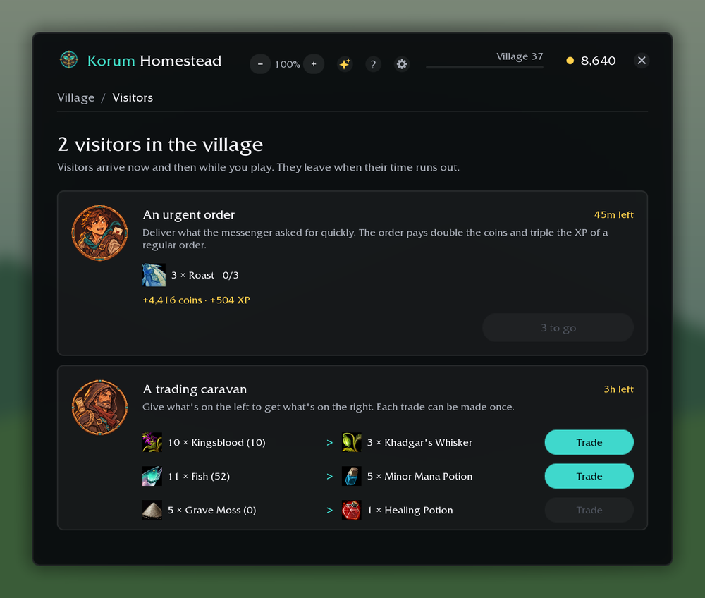
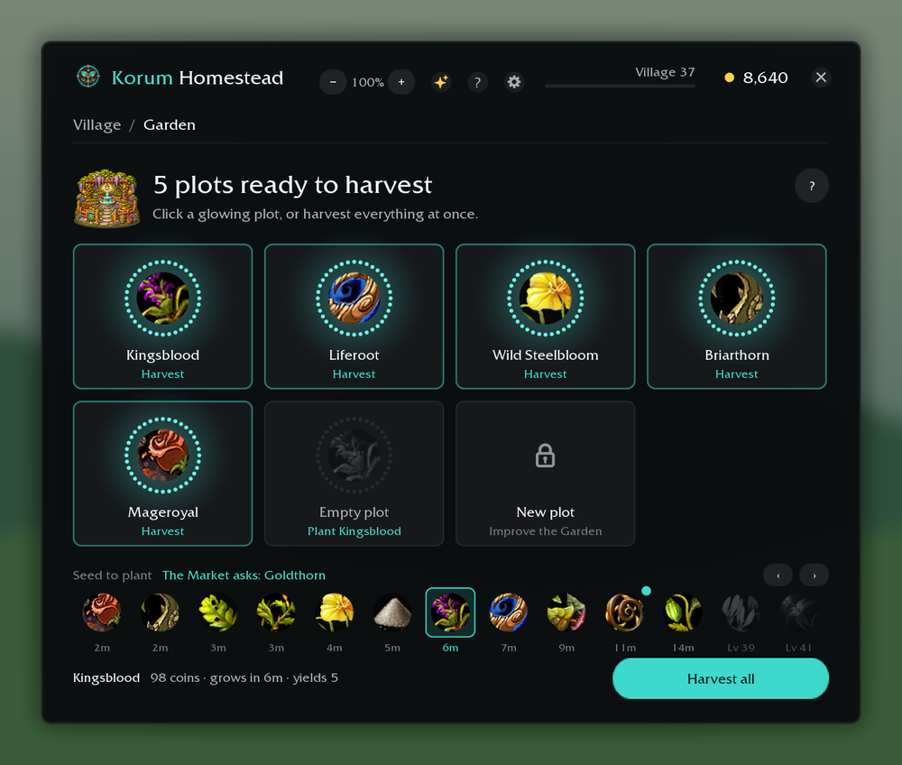
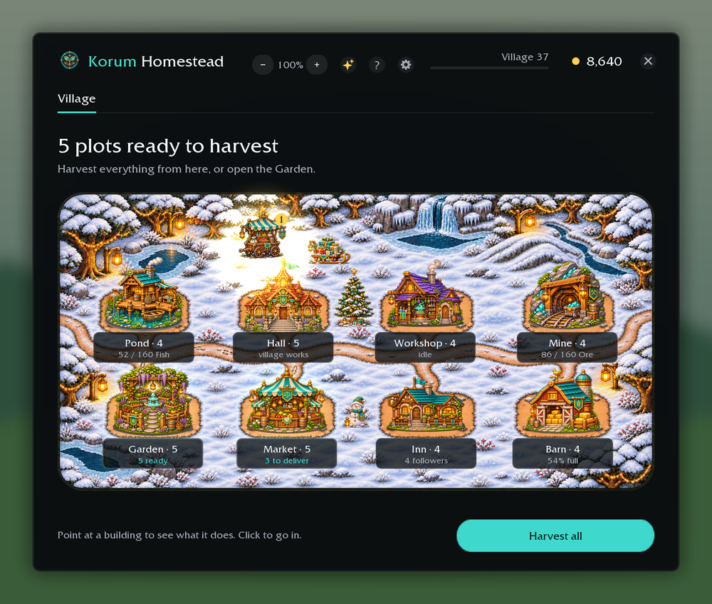
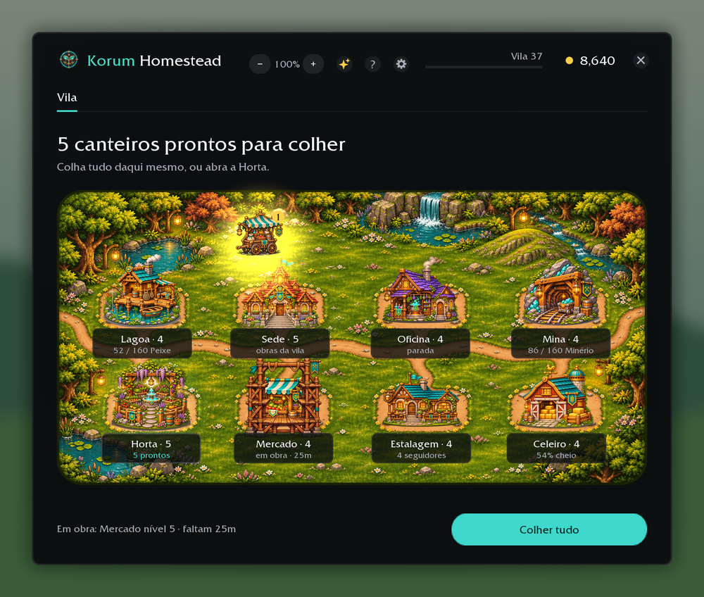
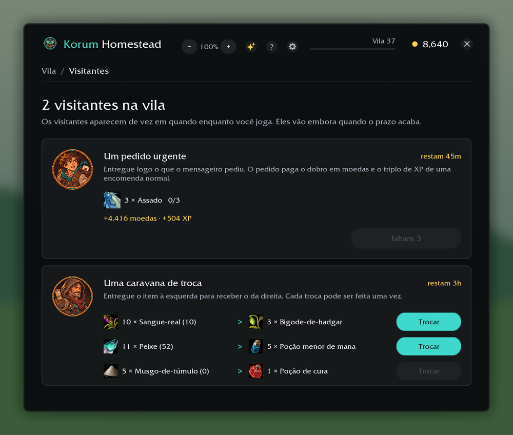
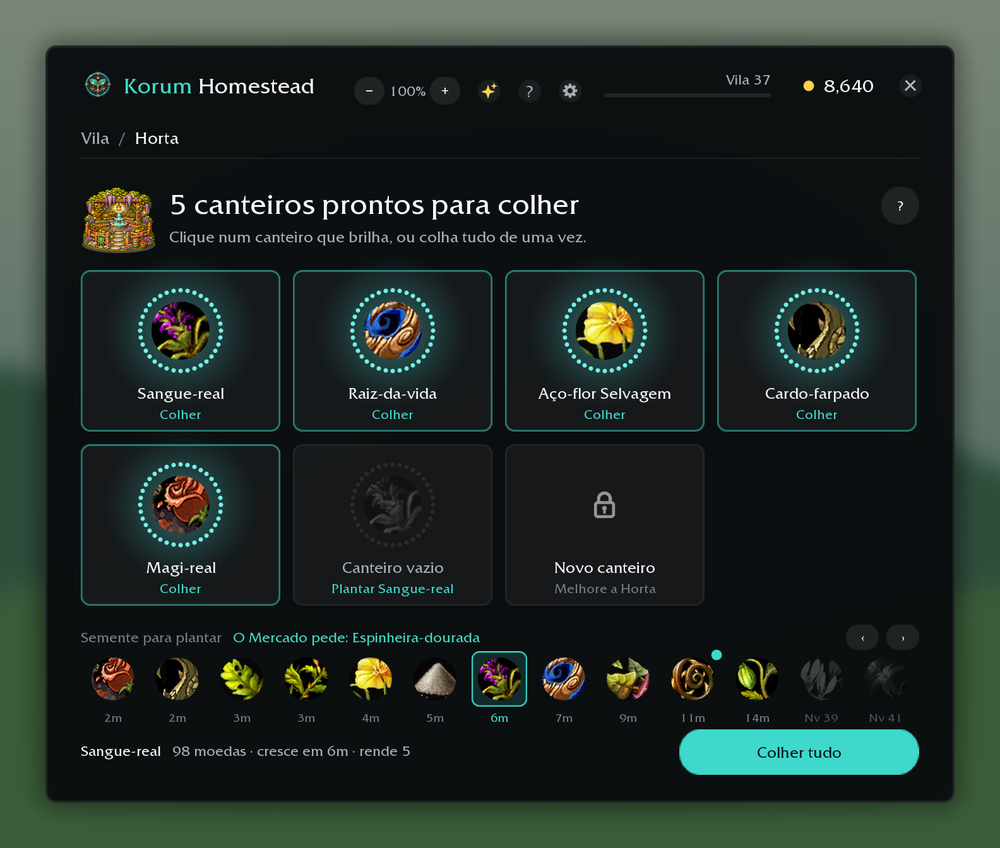
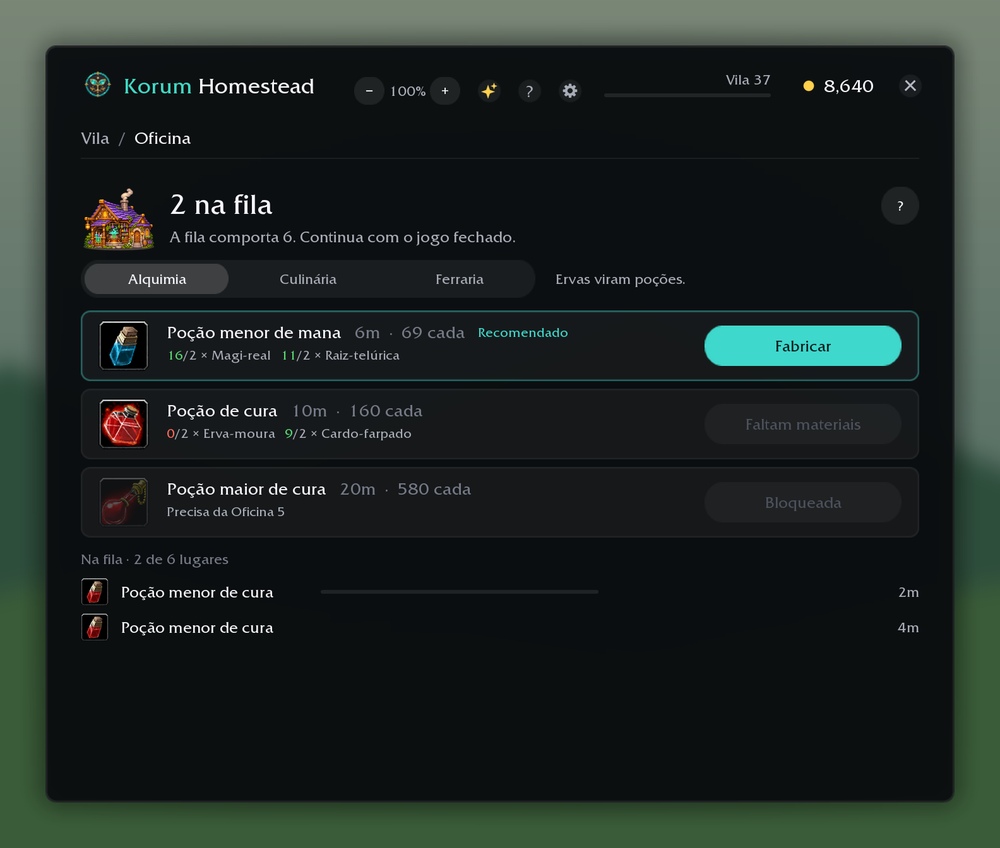
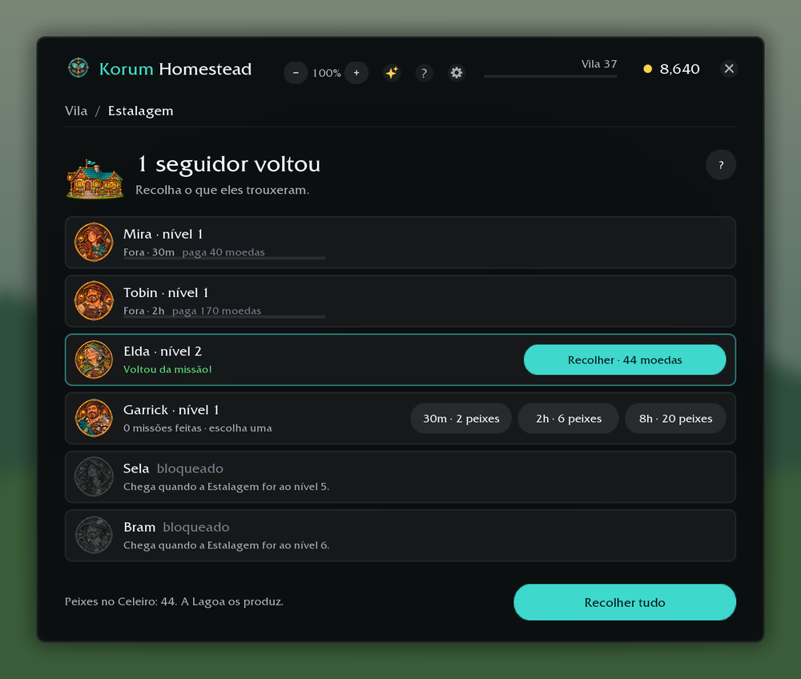
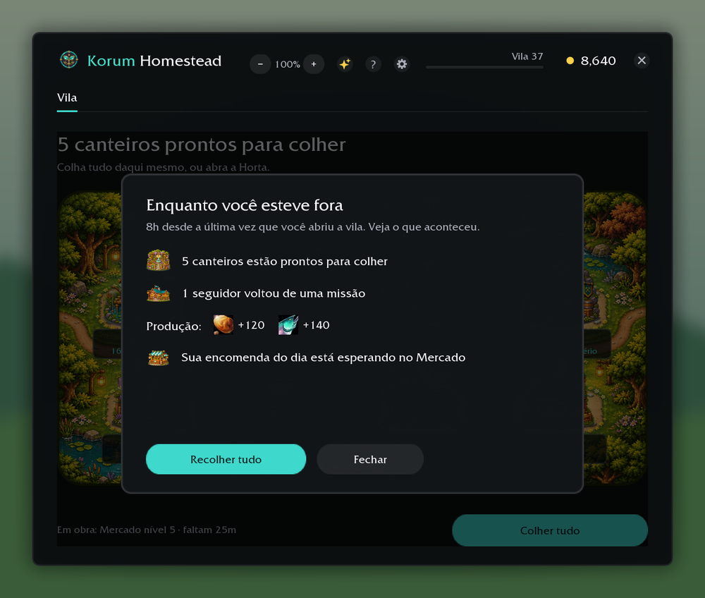
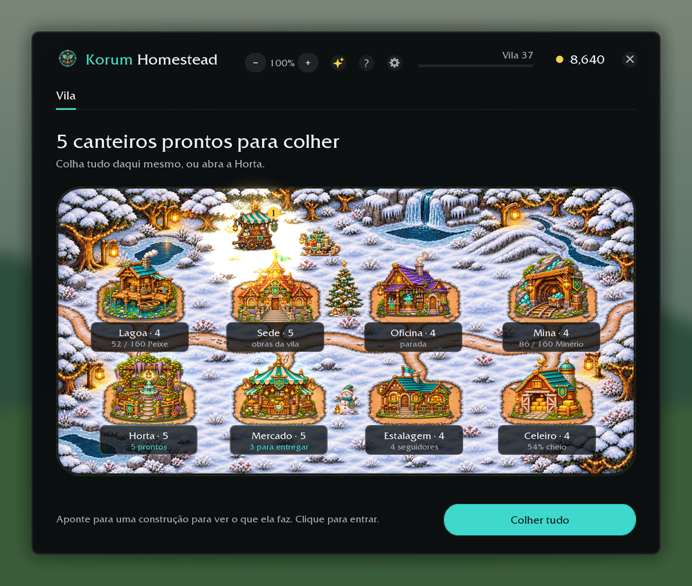

## Turn the time between adventures into your own village

Waiting for a dungeon? On a flight or boat? A few minutes before the next raid? Put that downtime to work in Korum Homestead.

Plant herbs, fill orders, craft useful goods, improve your buildings, welcome visitors and send followers on missions. Your village keeps producing while you're away, so there's always a harvest to collect, a follower to welcome home or a new upgrade to plan when you return.

Korum Homestead adds a relaxing village life to WoW without touching your character, inventory or gold. Everything you earn stays in the village, and you don't need any other addon to play.

## Make your village your own

*   **Village** - build eight buildings on a hand-drawn map, with seven levels to grow through. Raise your Village from level 1 to 60 and unlock something new along the way.
*   **Garden** - plant 27 herbs from the game, from Peacebloom to Icecap. Each has its own growing time, so there's always another crop to plan.
*   **Barn and Market** - turn your harvest into coins or fill residents' orders for more coins and XP. The order of the day and its streak give you a reason to come back tomorrow.
*   **Hall** - choose your next project and improve the village one building at a time. It points you to a useful upgrade for where you are now.
*   **Mine and Pond** - let ore and fish gather over time, then collect them when you're ready.
*   **Workshop** - make 21 recipes across Alchemy, Cooking and Smithing. Crafted goods are worth more than their ingredients.
*   **Inn** - recruit up to six followers and send them on missions. Welcome them back with coins and goods, and watch their experience grow.
*   **Visitors** - keep an eye out while you play. A messenger, generous merchant, trading caravan, rare fish or rare ore can bring a limited-time opportunity. *(2.1 alpha)*
*   **Festivals** - celebrate the season as your village changes for the Feast of Winter Veil, with snow, a decorated tree, a snowman and a sled full of gifts. *(2.1 alpha)*
*   **While you were away** - come back to a quick summary of what's ready, who returned and what was made.
*   **Easy to learn** - each building introduces itself on your first visit, and a complete guide is always there when you need it.
*   **Always close by** - minimize your village to a floating icon that lets you know when something is ready. Place it anywhere on screen or open the village from the minimap button.
*   **Made for your adventures** - the village hides itself when combat begins, so it stays out of the way when the action starts.
*   **One village per account.**
*   **Available in English and Brazilian Portuguese.**

## Get started

Type **/kh**, click the village icon or use the minimap button.

Start in the Garden: choose a seed and plant it. When it's ready, harvest your herbs, visit the Market and put your rewards toward the next step for your village. A few minutes now can set up your next visit.

Coming from version 1.0? Your village carries over, so everything you've built and earned stays with you.

## Commands

*   **/kh** - open or close your village
*   **/kh harvest** - collect everything that's ready
*   **/kh help** - see all available commands

## Feedback

Have an idea, spotted a problem or want to tell us what you'd like to see next?

Leave a comment or open an issue on [GitHub](https://github.com/joaomenestrina-debug/KorumHomestead).

***

## Faça o tempo entre aventuras render uma vila sua

Na fila de uma masmorra? A caminho de barco ou de voo? Com alguns minutos até a próxima raide? Aproveite esse intervalo para fazer sua vila crescer no Korum Homestead.

Plante ervas, atenda encomendas, produza itens, melhore construções, receba visitantes e envie seguidores em missões. A vila continua produzindo enquanto você está longe. Quando voltar, pode colher, receber seus seguidores e escolher a próxima melhoria.

Korum Homestead traz uma atividade tranquila para o seu tempo no WoW, sem mexer no personagem, no inventário ou no ouro. Tudo o que você conquista fica dentro da vila, e nenhum outro addon é necessário.

## Dê forma à sua vila

*   **Vila** - construa oito prédios num mapa desenhado à mão e desenvolva cada um por sete níveis. Faça sua Vila crescer do nível 1 ao 60 e descubra novidades pelo caminho.
*   **Horta** - plante 27 ervas do jogo, cada uma com seu próprio tempo de crescimento. Sempre há uma próxima colheita para planejar.
*   **Celeiro e Mercado** - transforme sua colheita em moedas ou atenda às encomendas dos moradores para ganhar mais moedas e XP. A encomenda do dia e sua sequência dão motivo para voltar amanhã.
*   **Sede** - escolha a próxima obra e melhore a vila, uma construção de cada vez. Ela indica uma melhoria útil para o momento.
*   **Mina e Lagoa** - deixe minérios e peixes se acumularem com o tempo e recolha tudo quando quiser.
*   **Oficina** - prepare 21 receitas de Alquimia, Culinária e Ferraria. Os produtos fabricados valem mais que seus ingredientes.
*   **Estalagem** - recrute até seis seguidores e envie-os em missões. Receba-os de volta com moedas e mercadorias enquanto ganham experiência.
*   **Visitantes** - fique de olho enquanto joga. Um mensageiro, um mercador generoso, uma caravana, um peixe raro ou um veio de minério podem trazer uma oportunidade por tempo limitado. *(2.1 alpha)*
*   **Festivais** - celebre a época com mudanças na vila durante o Festival do Véu de Inverno: neve, árvore enfeitada, boneco de neve e trenó cheio de presentes. *(2.1 alpha)*
*   **Enquanto você esteve fora** - volte e veja de uma vez o que ficou pronto, quem retornou e o que foi produzido.
*   **Fácil de aprender** - cada construção se apresenta na primeira visita, e um guia completo está sempre disponível.
*   **Sempre por perto** - minimize a vila em um ícone flutuante que avisa quando algo fica pronto. Posicione-o onde quiser na tela ou abra a vila pelo botão no minimapa.
*   **Feito para suas aventuras** - a vila se esconde quando o combate começa e sai do caminho na hora da ação.
*   **Uma vila por conta.**
*   **Disponível em inglês e português brasileiro.**

## Comece agora

Digite **/kh**, clique no ícone da vila ou use o botão no minimapa.

Comece pela Horta: escolha uma semente e plante. Quando estiver pronta, faça a colheita, passe no Mercado e use as recompensas para dar o próximo passo na sua vila. Alguns minutos agora já preparam sua próxima visita.

Vem da versão 1.0? Sua vila continua aqui, com tudo o que você construiu e conquistou.

## Comandos

*   **/kh** - abre ou fecha sua vila
*   **/kh colher** (ou **/kh harvest**) - colhe tudo o que estiver pronto
*   **/kh ajuda** (ou **/kh help**) - mostra todos os comandos disponíveis

## Feedback

Teve uma ideia, encontrou um problema ou quer contar o que gostaria de ver no addon?

Deixe um comentário ou abra uma solicitação no [GitHub](https://github.com/joaomenestrina-debug/KorumHomestead).
